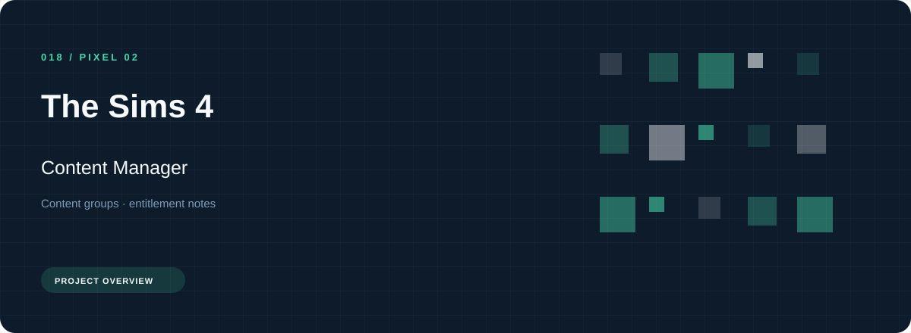
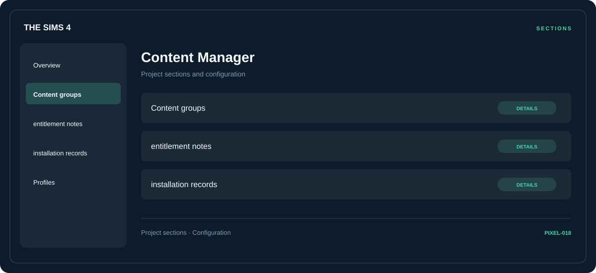

# ⚡ The Sims 4 Content Manager

**Content groups · Entitlement notes · Installation records**

## ⚡ Features

The Sims 4 Content Manager uses a concise workspace for content groups, entitlement notes, and installation records. The feature map follows the same order as the project navigation.

### ⚙️ Content groups

Content and resource groups, together with their configuration or organization details.

### 🧩 Entitlement notes

A dedicated section for entitlement notes and the configuration details associated with that area.

### ⌨️ Installation records

A dedicated section for installation records and the configuration details associated with that area.

## 🖥️ Project navigation

## 📥 Download

The button and cover open the project's download page. Use the information supplied with the downloaded package for installation and release-specific requirements.

## 📚 Project documentation

- [Feature reference](docs/FEATURES.md)
- [Download information](docs/DOWNLOAD.md)
- [Project page](index.html)

---

The Sims 4 Content Manager · Program documentation and download information.
                                                                                                    